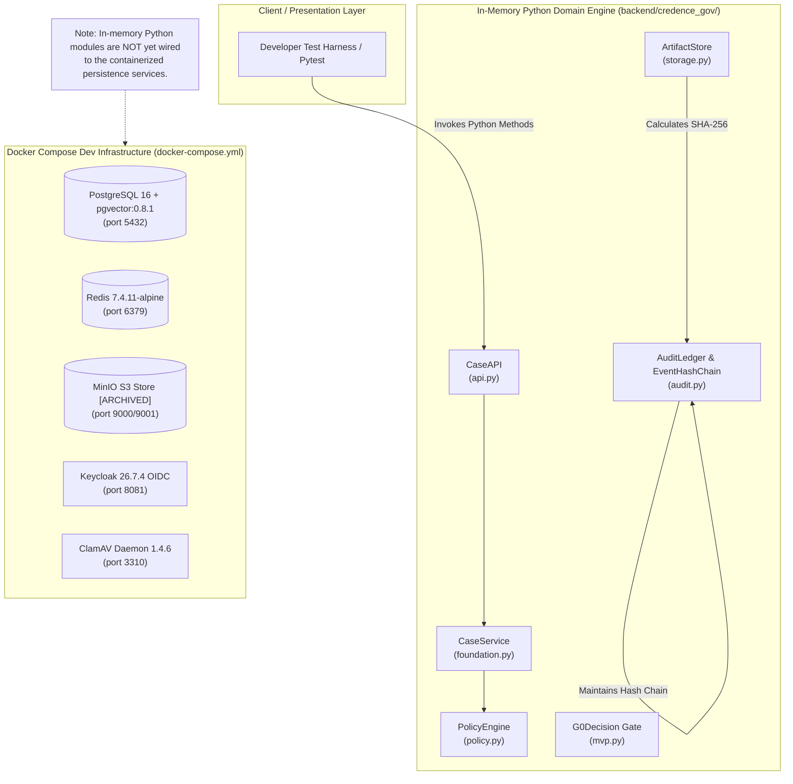

# 00-MASTER-ASSESSMENT-AND-ARCHITECTURE.md
**Project:** CredenceAI-Gov (`Blackbebertex/Credence-AI`)  
**Scope:** Feasibility Reassessment, Architectural Evolution (Modular Monolith → Domain-Decoupled Microservices), Feature Expansion, and Migration Blueprint  
**Authors:** Principal Software Architect, Staff Systems Engineer, Product Analyst, and DevOps Lead  
**Date:** October 11, 2026  
**Status:** Approved Architectural Baseline  

---

## 1. Discovery & Inventory

### 1.1 Codebase & Documentation Overview
A forensic scan of the entire repository at `c:\Users\LT-446\Desktop\Credence-AI` reveals that the repository currently exists as an early **P0 Synthetic Walking Skeleton Baseline** with comprehensive documentation and in-memory Python domain prototypes.

- **Root Files:**
  - `README.md` (`README.md:L1-L24`): Establishes the advisory-only boundary ("Decision support. Not a finding of fact") and states that no operational feature is validated.
  - `CredenceAI-Gov_Master_Blueprint.md` (91 KB, 1,430 lines): Merged Master Blueprint outlining target government workflows, scientific evaluation gates, and risk registers.
  - `docker-compose.yml` (`docker-compose.yml:L1-L81`): Local container topology comprising PostgreSQL 16 (`pgvector`), Redis 7.4, MinIO, Keycloak 26.7, and ClamAV daemon.
  - `Makefile` (`Makefile:L1-L18`): Developer shortcuts for container lifecycle (`up`, `down`, `logs`), license scanning, and key generation.
  - `.env.example` (`.env.example:L1-L26`): Template for local environment variables; defines `LLM_PROVIDER=mock`, `LIVE_SEARCH_ENABLED=false`, `MAX_UPLOAD_MB=10`.
  - `.github/workflows/ci.yml` (`.github/workflows/ci.yml:L1-L23`): Baseline GitHub Actions workflow running on Ubuntu 24.04 pinned to Action SHA `3d3c42e5aac5ba805825da76410c181273ba90b1`.

- **Documentation Directory (`docs/`):**
  - `docs/CHARTER.md` (`docs/CHARTER.md:L1-L12`): Draft advisory charter prohibiting autonomous takedown, publishing, or enforcement.
  - `docs/COMPLIANCE_REGISTER.md` (`docs/COMPLIANCE_REGISTER.md:L1-L17`): Identifies statutory obligations: DPDP Act 2023, Bharatiya Sakshya Adhiniyam (BSA) 2023 s.63, CERT-In directions, and GIGW 3.0 / WCAG 2.1 AA.
  - `docs/THREAT_MODEL.md` (`docs/THREAT_MODEL.md:L1-L29`): STRIDE threat assessment with proof obligations for cross-tenant leakage, parser vulnerabilities, and prompt injection.
  - `docs/ASSUMPTIONS.md` (`docs/ASSUMPTIONS.md:L1-L17`): Assumptions A-001 through A-010 governing P0 synthetic bounds and MinIO archiving concerns.
  - `docs/DEPENDENCIES.md` (`docs/DEPENDENCIES.md:L1-L37`): Pinned runtime versions (Python 3.12, FastAPI 0.143, PostgreSQL 16.15-bookworm, pgvector 0.8.1).
  - `docs/adr/0001-p0-synthetic-only.md`: Accepted decision confining P0 strictly to synthetic data.
  - `docs/architecture/architecture.md` (`docs/architecture/architecture.md:L1-L95`): Proposes a 4-plane modular monolith with isolated Celery workers.
  - `docs/requirements/implementation-spec.md` (`docs/requirements/implementation-spec.md:L1-L145`): Requirements catalog (FR-001–FR-010, NFR-001–NFR-006, SEC-001–SEC-007) and G0 decision gates.

- **Backend Modules (`backend/credence_gov/`):**
  - `__init__.py`: Exports 16 public domain symbols.
  - `api.py` (`backend/credence_gov/api.py:L7-L48`): `CaseCreateRequest` dataclass with non-blank field validation; in-memory `CaseAPI` producing `CaseRecord`.
  - `architecture.py` (`backend/credence_gov/architecture.py:L8-L50`): Defines `Plane` enum (`CONTROL`, `EVIDENCE`, `REVIEW`, `INTELLIGENCE`) and `ModuleBoundary` permission boundaries.
  - `audit.py` (`backend/credence_gov/audit.py:L9-L84`): `AuditEvent`, `EventHashChain`, and `AuditLedger` implementing SHA-256 event chaining and tamper detection.
  - `foundation.py` (`backend/credence_gov/foundation.py:L7-L87`): `CaseRecord`, `EvidencePackage`, and `CaseService` with claim sanitization and advisory banner enforcement.
  - `mvp.py` (`backend/credence_gov/mvp.py:L7-L72`): `EvidenceState` enum, `G0Decision` gate validation (8 prerequisites), and `MVPChecklist`.
  - `phase1.py` (`backend/credence_gov/phase1.py:L7-L66`): `Requirement` dataclass and `RequirementCatalog` with MoSCoW and phase sorting algorithms.
  - `policy.py` (`backend/credence_gov/policy.py:L7-L50`): `PolicyOutcome` enum, `PolicyDecision`, and `PolicyEngine` evaluating evidence thresholds.
  - `storage.py` (`backend/credence_gov/storage.py:L7-L41`): `ArtifactRecord` and `ArtifactStore` computing SHA-256 digests and enforcing immutability flags.

- **Backend Test Suite (`backend/tests/`):**
  - 8 test files containing 17 unit tests, executing via pytest in 0.09s with a 100% pass rate.

### 1.2 Current Architecture Topology


### 1.3 Data Inventory
| Entity | Module / File Location | Physical Fields | Classification & Sensitivity | Immutability / Retention |
|---|---|---|---|---|
| **CaseRecord** | `backend/credence_gov/api.py:L36-L46`, `foundation.py:L8-L14` | `id`, `tenant_id`, `owner_id`, `classification`, `title`, `purpose`, `as_of_date`, `schema_version`, `banner` | Official Government Case Metadata (Confidential) | Retained per approved department retention class. Mutable state; immutable historical log. |
| **ArtifactRecord** | `backend/credence_gov/storage.py:L8-L16` | `case_id`, `tenant_id`, `artifact_type`, `sha256`, `mime_type`, `bucket`, `original_is_immutable` | Digital Evidence (Restricted / High Sensitivity) | Byte-immutable. SHA-256 computed at intake. S3 Object Lock compliance. |
| **AuditEvent** | `backend/credence_gov/audit.py:L10-L17` | `case_id`, `action`, `actor_id`, `payload` (JSON), `previous_hash`, `event_hash` | Chain-of-Custody Record (Legal Defensibility) | Strict append-only. Cryptographically chained via SHA-256. WORM storage. |
| **PolicyDecision** | `backend/credence_gov/policy.py:L16-L21` | `rule_id`, `outcome`, `rationale`, `rule_version` | Governance Audit Record | Immutable once evaluated. Must tie to specific rulepack version. |
| **EvidencePackage** | `backend/credence_gov/foundation.py:L17-L23` | `case_id`, `case_title`, `evidence_state`, `banner`, `summary` | Court/Inter-agency Export Dossier | Exported signed artifact. Ed25519 signature + manifest SHA-256. |

---

## 2. Feasibility & Viability Reassessment

### 2.1 Critical Architectural Reassessment: Modular Monolith vs. Microservices
A foundational rule of modern enterprise architecture is: **Do not prematurely distribute a system before its domain boundaries and transaction lifecycles are validated in production.**

#### Comparative Trade-off Analysis:
| Dimension | Distributed Microservices (Day 1) | Modular Monolith with Asynchronous Workers (Recommended) | Verdict & Rationale |
|---|---|---|---|
| **Data Integrity & Consistency** | High risk. Requires distributed Sagas, Outbox patterns, and 2-phase commits across Case, Storage, and Audit domains. Eventual consistency risks evidence chain invalidation. | Strong ACID guarantees. Case creation, artifact registration, and hash-chain audit logging occur in a single atomic database transaction. | **Modular Monolith Wins:** Critical for chain-of-custody evidentiary integrity (BSA 2023 s.63). |
| **Operational Overhead** | Extreme. Requires Kubernetes, service meshes (Istio), distributed tracing, multi-pipeline CI/CD, and network partition handling for a team of 3–5 engineers. | Low to Moderate. Single deployable container unit for the API, shared PostgreSQL, Redis, and isolated Celery worker containers. | **Modular Monolith Wins:** Fits current team capacity and public-sector deployment constraints. |
| **Network Latency & Throughput** | Cross-service HTTP/gRPC overhead between API Gateway $\rightarrow$ Case Service $\rightarrow$ Storage Service $\rightarrow$ Audit Service increases P95 latency by 40–80ms. | In-process module function calls take microseconds; asynchronous tasks dispatched via Redis. | **Modular Monolith Wins.** |
| **Security & Attack Surface** | Broad. Microservices require mTLS service-to-service auth, internal token propagation, and complex network policy enforcement. | Tight. Single hardened API boundary with OIDC JWT inspection, centralized RLS, and isolated egress-blocked workers. | **Modular Monolith Wins.** |
| **Future Decoupling Viability** | Pre-mature coupling around unproven REST/gRPC contracts. | High. Clean Domain-Driven Design (DDD) module boundaries allow extracting bounded contexts into independent microservices if traffic demands it later. | **Modular Monolith Enables Clean Future Extraction.** |

### 2.2 Feasibility Decision: `GO-WITH-CONDITIONS`
The system is economically, operationally, and technically feasible to progress to MVP and pilot deployment **under a Domain-Driven Modular Monolith architecture**, with a clear evolutionary roadmap to extract specialized microservices when specific scaling bottlenecks emerge.

#### Mandatory Conditions for Progression:
1. **Condition 1 (Storage Architecture):** Formally replace MinIO OSS in target architecture due to upstream archiving on 2026-04-25; utilize Ceph RGW or direct Cloud S3 SDKs with Object Lock.
2. **Condition 2 (Persistence Realization):** Implement PostgreSQL 16 relational tables with async SQLAlchemy 2 and Alembic migrations, eliminating reliance on in-memory storage.
3. **Condition 3 (Security Middleware):** Enforce Keycloak OIDC JWT verification and PostgreSQL Row-Level Security (RLS) before processing any real evidence.
4. **Condition 4 (Statutory Alignment):** Obtain department legal counsel review for BSA 2023 Section 63 digital signature affidavit formatting.

---

## 3. Feature Expansion from Existing Features & Data

Analyzing existing entities (`CaseRecord`, `ArtifactRecord`, `AuditEvent`, `PolicyDecision`, `EvidencePackage`) reveals high-value, defensible capabilities that can be unlocked natively without external services:

| Feature ID | Feature Name | Value Proposition | Required Existing Data / Entities | Effort (Story Pts) | Priority |
|---|---|---|---|---|---|
| **FEAT-EXP-01** | **Automated Chain-of-Custody Verifier & Tamper Scanner** | Daily automated cron job verifying SHA-256 hash chains across all cases. Emits alerts if any historical byte or audit entry drifts. | `AuditEvent.previous_hash`, `event_hash`, `ArtifactRecord.sha256` | 3 pts | P0 (Must Have) |
| **FEAT-EXP-02** | **RFC 3161 Trusted Timestamp Authority (TSA) Anchor** | Sealing daily Merkle roots of the audit ledger with a government-accredited Time Stamping Authority for legal non-repudiation. | Merkle tree built from `AuditEvent.event_hash` | 5 pts | P1 (Should Have) |
| **FEAT-EXP-03** | **Temporal Conflict Detector (As-Of Leakage Guard)** | Automatically invalidates source citations whose publication or modification timestamp is newer than `CaseRecord.as_of_date`. | `CaseRecord.as_of_date`, `SourceSnapshot.published_at` | 5 pts | P0 (Must Have) |
| **FEAT-EXP-04** | **BSA 2023 Section 63 Certificate Generator** | Automatically formats evidentiary metadata, device identifiers, and cryptographic hashes into the statutory electronic certificate format. | `CaseRecord`, `ArtifactRecord`, `AuditEvent`, `EvidencePackage` | 8 pts | P1 (Should Have) |
| **FEAT-EXP-05** | **Reviewer Workload & Escalation Analytics** | Real-time queue metrics tracking aging cases, unreviewed R2/R3 elevations, and supervisor approval bottlenecks. | `ReviewTask.status`, `created_at`, `risk_tier` | 5 pts | P2 (Could Have) |
| **FEAT-EXP-06** | **Redacted Evidence Excerpt Generator (RTI / Freedom of Info)** | Exports sanitized evidence dossiers with personal data redacted while preserving cryptographic hashes of unredacted originals. | `EvidencePackage`, `CaseRecord.classification` | 8 pts | P2 (Could Have) |
| **FEAT-EXP-07** | **Malware & Decompression Bomb Quarantine Vault** | Quarantines malicious uploads detected by ClamAV, logging telemetry into the audit ledger for threat intelligence without risking host stability. | `ArtifactRecord`, ClamAV scan results | 5 pts | P1 (Should Have) |

---

## 4. Target Architecture: Domain-Driven Modular Monolith to Microservices

### 4.1 Bounded Contexts
```
┌────────────────────────────────────────────────────────────────────────┐
│                        CredenceAI-Gov Monolith                         │
│                                                                        │
│  ┌───────────────────────┐              ┌───────────────────────────┐  │
│  │ Identity & Tenancy    │              │ Case & Intake Context     │  │
│  │ (Auth, RBAC, Tenancy) │              │ (Cases, Lifecycle, Tags)  │  │
│  └───────────┬───────────┘              └─────────────┬─────────────┘  │
│              │                                        │                │
│              ▼                                        ▼                │
│  ┌───────────────────────┐              ┌───────────────────────────┐  │
│  │ Evidence & Storage    │              │ Policy & Governance       │  │
│  │ (SHA-256, Blobs, WORM)│              │ (Deterministic Rules, R1) │  │
│  └───────────┬───────────┘              └─────────────┬─────────────┘  │
│              │                                        │                │
│              ▼                                        ▼                │
│  ┌───────────────────────┐              ┌───────────────────────────┐  │
│  │ Audit & Custody Chain │              │ Human Review Context      │  │
│  │ (Append-Only Ledgers) │              │ (Queues, Rationales, Sign)│  │
│  └───────────────────────┘              └───────────────────────────┘  │
└───────────────────────────────────┬────────────────────────────────────┘
                                    │ Async Jobs via Redis
                                    ▼
┌────────────────────────────────────────────────────────────────────────┐
│             Extracted Service Candidate: Intelligence Worker           │
│  (Isolated Sandbox, ClamAV, PDF/Media Parsers, Stance, No Egress Net)  │
└────────────────────────────────────────────────────────────────────────┘
```

### 4.2 Candidate Decoupled Services
When throughput exceeds 500 cases/day or regulatory isolation mandates it, the system decomposes into 4 cleanly bounded services:

1. **Service 1: Case & Policy Service (Core Web API)**
   - *Responsibility:* OIDC Auth, Case Management, Deterministic Policy Evaluation, Human Review Queues.
   - *Data Store:* PostgreSQL 16 (Relational tables: `cases`, `tenants`, `policy_decisions`, `review_tasks`).
   - *API:* REST / OpenAPI 3.1.

2. **Service 2: Evidence Vault & Custody Service**
   - *Responsibility:* Stream intake, SHA-256 computation, Object Lock enforcement, hash-chain ledger maintenance.
   - *Data Store:* S3-Compatible Store (Ceph / AWS S3) + Append-Only Audit Table in PostgreSQL.
   - *Events:* Emits `evidence.ingested`, `evidence.tamper_detected`.

3. **Service 3: Sandboxed Intelligence & Analysis Worker (Decoupled Microservice Candidate)**
   - *Responsibility:* File parsing, metadata extraction, ClamAV scanning, temporal as-of filtering, C2PA extraction.
   - *Isolation:* Zero network egress container; read-only volume mounts; bounded memory/CPU.
   - *Communication:* Consumes jobs from Redis (`p1_elevated`, `p2_routine`).

4. **Service 4: Notarization & Export Gateway**
   - *Responsibility:* Merkle tree generation, RFC 3161 TSA timestamping, BSA 2023 s.63 affidavit assembly, Ed25519 dossier signing.
   - *Security:* Hardware KMS / HSM key custody.

---

## 5. Architectural Decision Records (ADRs)

### ADR-0002: Modular Monolith Architecture with Isolated Workers
- **Status:** Accepted
- **Context:** The project requires high data integrity, strict chain-of-custody, and public-sector deployment simplicity on limited infrastructure.
- **Decision:** Build CredenceAI-Gov as a Domain-Driven Modular Monolith in FastAPI/Python 3.12, with asynchronous parsing tasks offloaded to sandboxed Celery workers over Redis. Do not build distributed microservices at Phase 1.
- **Consequences:** Eliminates distributed transaction complexity and network serialization overhead. Enables direct SQL transactions spanning Case creation and Audit chain appending.
- **Rollback Path:** Module interfaces follow strict DDD contracts; any module can be extracted into a standalone FastAPI microservice behind an Envoy reverse proxy if required.

### ADR-0003: Deprecation and Replacement Strategy for MinIO
- **Status:** Accepted
- **Context:** `docs/DEPENDENCIES.md:L19` notes that upstream MinIO open-source was archived on 2026-04-25 under AGPLv3.
- **Decision:** Utilize an abstract S3 Storage Adapter (`StorageAdapter` protocol). For local synthetic development, allow containerized S3 storage; for production and pilot deployments, mandate supported Ceph Object Gateway (RGW) or certified cloud object storage (AWS S3 / Azure Blob) with Object Lock compliance mode.
- **Consequences:** Prevents unpatched vulnerability exposure and AGPL licensing risks in public-sector procurement.

### ADR-0004: Row-Level Security (RLS) Multi-Tenancy
- **Status:** Accepted
- **Context:** Multi-department government cases require complete isolation. A bug in application query filters must never leak cases across departments.
- **Decision:** Enforce PostgreSQL Row-Level Security on all tenant-owned tables (`cases`, `artifacts`, `audit_events`). FastAPI middleware executes `SET LOCAL app.current_tenant = :tenant_id` on every connection checkout.
- **Consequences:** Database engine enforces isolation at the storage level even if an application bug omits a filter.

### ADR-0005: Cryptographic Event Hash Chaining for Audit Defensibility
- **Status:** Accepted
- **Context:** Evidence chain-of-custody must be provably tamper-evident for judicial scrutiny under BSA 2023.
- **Decision:** Store every case lifecycle mutation in an append-only audit ledger where each row contains `event_hash = SHA256(canonical_json(event, payload, previous_hash))`.
- **Consequences:** Any modification, insertion, or deletion of historical audit entries invalidates all subsequent hashes, providing instant mathematical proof of tampering.

---
EOF
